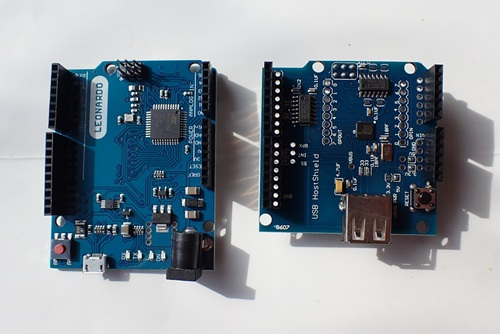
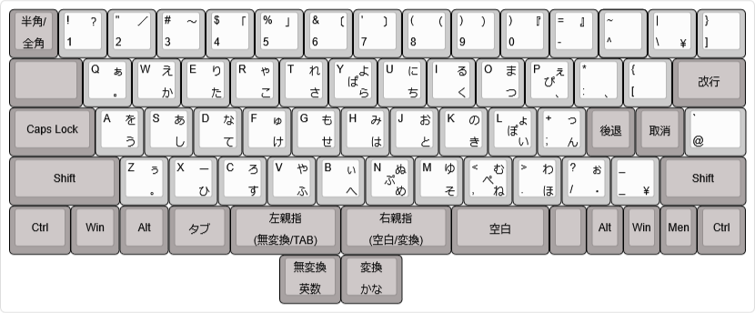
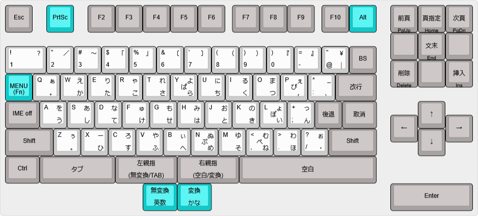

# hoboNicolaキーボードアダプター

本プロジェクトは、Takeshi Higasa 氏によるオリジナルの **hoboNicola keyboard and adapter library**
（Copyright (c) Takeshi Higasa, okiraku-camera.tokyo）
をベースに、いくつかの変更と機能追加を行ったものです。

詳細については、次の記事を参照してください。

- RP2040とUSB mini Hostを使ったhoboNicolaアダプター  
  https://note.com/ja7rhk/n/n8317710966b9

- Pro MicroとUSB mini Hostを使ったhoboNicolaアダプター   
  https://note.com/ja7rhk/n/n7c483209e886

## ● examples / usb_hobo_nicola
富士通製の親指シフトキーボードは現在では入手が難しくなっていますが、NuPhy Nude75 JIS のようにキーマップを自由に変更できるキーボードを利用することで、親指シフト環境を構築できます。
本プロジェクトでは、キーキャップを入れ替えて OASYS 系列の NICOLA-F レイアウト風にした NuPhy Nude75 JIS を対象として動作確認を行っています。

以下のUSB mini Host v.2.0搭載ボードに対応しています。

### Waveshare RP2040 Zero

### Pro Micre (5V/16MHz)

### Arduino Leonardo

## ● examples / ps2_hobo_nicola_KB611

FMV-KB611をUSBインタフェースに変換します。JIS109キーボードとして初期化してNicola化します。  
https://note.com/ja7rhk/n/n99ed14a7aaab

### FMV-KB611 PS/2インタフェース

## ● examples / oasys30_hobo_nicola

ワープロOASYS30のキーボードをUSBインタフェースに変換します。  
https://note.com/ja7rhk/n/nd1b89d8d32c9

### OASYS30 シリアルインタフェース

