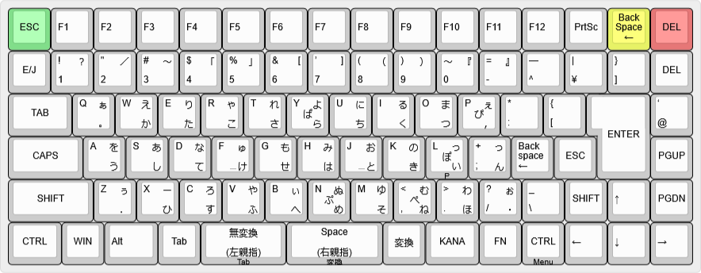
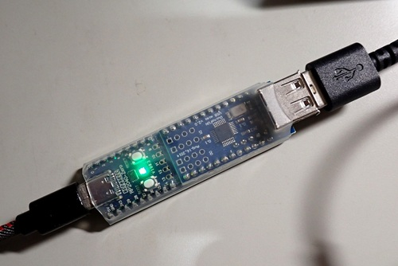
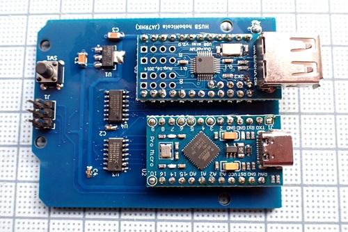
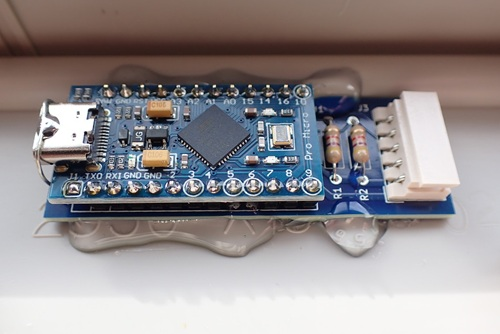
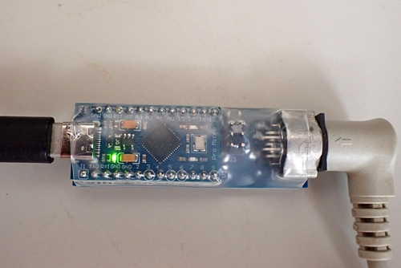

# hoboNicolaキーボードアダプター

本プロジェクトは、Takeshi Higasa 氏によるオリジナルの **hoboNicola keyboard and adapter library**
（Copyright (c) Takeshi Higasa, okiraku-camera.tokyo）
をベースに、いくつかの変更と機能追加を行ったものです。

詳細については、次の記事を参照してください。

- RP2040とUSB mini Hostを使ったhoboNicolaアダプター  
  https://note.com/ja7rhk/n/n8317710966b9

- Pro MicroとUSB mini Hostを使ったhoboNicolaアダプター   
  https://note.com/ja7rhk/n/n7c483209e886

## 想定しているキーボード

富士通製の親指シフトキーボードは現在では入手が難しくなっていますが、NuPhy Nude75 JIS のようにキーマップを自由に変更できるキーボードを利用することで、親指シフト環境を構築できます。

本プロジェクトでは、キーキャップを入れ替えて OASYS 系列の NICOLA-F レイアウト風にした NuPhy Nude75 JIS を対象として動作確認を行っています。

## Arduinoボード（アダプター用）

以下のUSB mini Host v.2.0搭載ボードに対応しています。

### Waveshare RP2040 Zero

### Pro Micre (16MHz)

上記以外に、Pro Micro (16MHz) ポード単独でPS2などのシリアルインタフェースをもったキーボードに対応しています。

### FMV-KB611 PS/2インタフェース

### OASYS30 シリアルインタフェース

